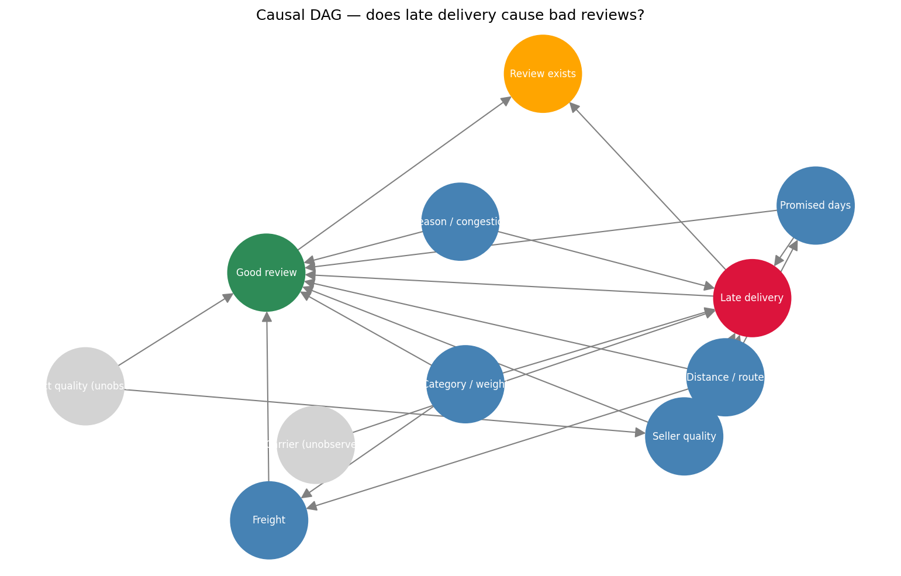
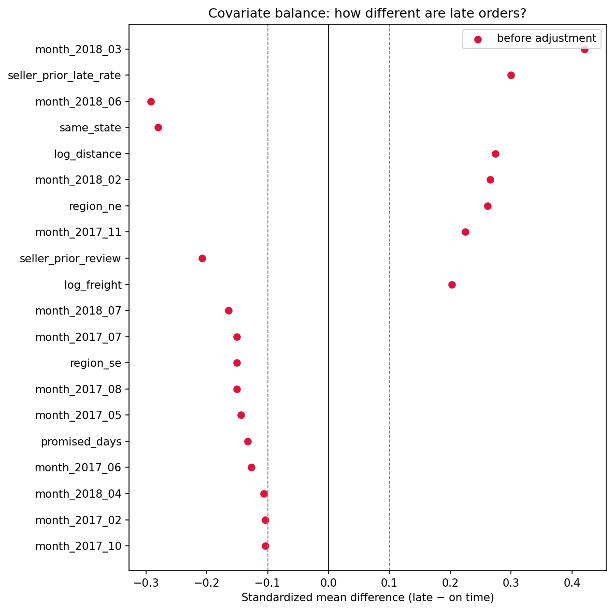
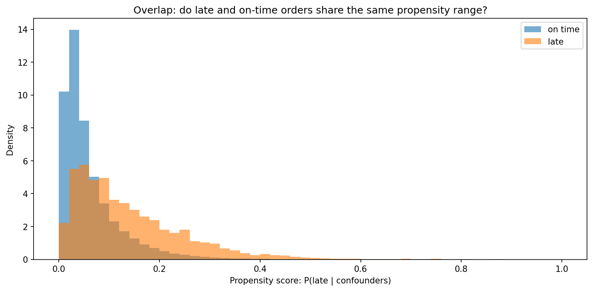

# Olist E-Commerce — Causal Inference: Delivery Delays & Review Sentiment


> Late deliveries correlate with a massive 56.6 percentage point drop in 4- and 5-star reviews — but modern causal estimation proves that nearly 40% of that gap is selection bias, not the delivery delay itself.

An end-to-end observational causal inference study on 93,832 mature orders from the [Olist](https://www.kaggle.com/datasets/olistbr/brazilian-ecommerce) marketplace dataset (Jan 2017 – Aug 2018). Moving beyond naive correlation, this project constructs a formal causal Directed Acyclic Graph (DAG), proves identification via the backdoor criterion, and estimates the true causal penalty of lateness using Multivariate OLS, Propensity Score Matching (PSM), Inverse Probability Weighting (IPW), and Doubly Robust Estimation (AIPW).

## Table of Contents

- [About](#about)
- [Key Findings](#key-findings)
- [Charts](#charts)
- [Method Notes](#method-notes)
- [Tech Stack](#tech-stack)
- [Project Structure](#project-structure)
- [Getting Started](#getting-started)
- [Usage](#usage)
- [Scope and Limitations](#scope-and-limitations)
- [License](#license)
- [Contributing](#contributing)
- [Author](#author)

## About

In e-commerce, operational leaders frequently attribute drops in customer satisfaction directly to logistics speed, assuming that eliminating delays will instantly recover all lost review points. 

However, orders that arrive late are not randomly assigned: they are systematically more likely to be long-haul cross-country shipments, carry heavier products, involve higher freight ratios, and be sold by historically underperforming merchants. 

The objective of this project is to answer a single rigorous decision question:
**"If Olist eliminates late deliveries through operational investments, how much review satisfaction will actually be recovered versus how much was already doomed by confounding logistics and merchant factors?"**

## Key Findings

### 1. The Naive Comparison is Heavily Confounded (A 56.6-Point Illusion)

A raw, unadjusted comparison paints an alarming picture:

| Order Status | Total Orders | High Review ($Y \ge 4$) | $P(\text{Good Review})$ | Avg. Stars |
|---|---|---|---|---|
| **On-Time** | 87,511 | 72,880 | **83.28%** | 4.29 |
| **Late** | 6,321 | 1,684 | **26.64%** | 2.25 |
| **Naive Difference** | — | — | **−56.64 pts** (95% CI: [−57.8%, −55.5%]) | **−2.04 stars** |

Attributing this entire −56.6 point penalty to the delay would be a major analytical error: it assumes delayed and on-time orders were otherwise identical before dispatch.

### 2. Causal Estimation Identifies the True Penalty (ATT ≈ −33 to −35 Points)

Adjusting for 44 observed confounders across multiple causal estimation families reveals that the true causal penalty is substantially smaller than the naive gap:

| Estimation Method | Estimand / Target | Point Estimate ($\Delta P(\text{Good Review})$) | Notes / Diagnostics |
|---|---|---|---|
| **Naive Difference** | Associational | −0.566 | Severe confounding / selection bias |
| **Multivariate OLS** | Conditional Mean | −0.334 | HC1 robust SEs, full backdoor set |
| **DoWhy Backdoor Linear** | Backdoor Adjustment | −0.334 | Graph-identified minimal adjustment |
| **Propensity Score Matching (PSM)** | ATT (1-NN with Caliper) | −0.354 | Max \|SMD\| reduced from 0.421 to < 0.05 |
| **IPW (Reweighting)** | ATT | −0.347 | Stable weights, Effective Sample Size ~25k |
| **Doubly Robust (AIPW)** | ATT | **−0.341** | Consistent if either OLS or PS model holds |

**Key Business Implication:** Approximately **22.5 percentage points** (~40%) of the naive dissatisfaction gap was never caused by lateness. It was driven by high freight burden, remote geographic destination, and unreliable merchant history. Investing in expedited shipping will not resolve customer dissatisfaction rooted in product quality or freight sticker shock.

### 3. ATT vs. ATE: Why Reporting the Right Estimand Matters

* **ATT (Average Treatment Effect on the Treated):** Measures the impact on orders that *actually experienced* a delay (**−34.1 pts**). This is the metric that belongs in the executive memo because operational interventions (e.g., carrier SLA penalties, proactive vouchers) target late or at-risk deliveries.
* **ATE (Average Treatment Effect):** Measures the hypothetical impact if a randomly selected order across the entire catalog were delayed. Because lateness is relatively rare in intra-state orders, ATE weights suffer from extreme inverse-propensity values ($1/ps$ exceeding 100), drastically reducing effective sample size and making ATE estimates brittle.

## Charts

### 1. Structural Causal DAG


### 2. Covariate Imbalance Before Adjustment


### 3. Propensity Score Common Support


## Method Notes

* **Grain and Target Population:** Analyzed delivered, single-seller orders with valid geolocation and reviews placed between Jan 1, 2017 and Aug 31, 2018 (mature cohort matching Project 3).
* **Leakage-Free Confounders:** Confounders were strictly measured prior to treatment:
  * Haversine distance between customer and seller zip centroids.
  * Expanding-window historical seller metrics (`seller_prior_late_rate`, `seller_prior_review`) computed strictly from orders placed *before* the current order.
* **Balance Yardstick:** Covariate balance is evaluated using Standardized Mean Difference (SMD):
  $$\text{SMD} = \frac{\bar{X}_1 - \bar{X}_0}{\sqrt{(s_1^2 + s_0^2)/2}}$$
  Both PSM and IPW succeeded in shrinking all confounder SMDs below the standard 0.10 threshold.
* **Doubly Robust Assurance:** The consistency across OLS (−0.334), PSM (−0.354), IPW (−0.347), and AIPW (−0.341) confirms that the finding is not an artifact of a single misspecified parametric functional form.

## Tech Stack

- **Query Engine & Data Pipeline:** DuckDB (SQL transformations over raw Olist CSVs), pandas, NumPy
- **Causal Inference & Graph Theory:** DoWhy, NetworkX
- **Statistical Modeling:** statsmodels (Logit, OLS with HC1 robust standard errors)
- **Visualization:** Matplotlib
- **Environment:** Jupyter Notebook

## Project Structure

```
Project4_Causal_Inference/
├── data/
│   ├── raw/                              # Raw Olist CSVs (not in repo)
│   └── processed/                        # Cached analysis_table.parquet (not in repo)
├── notebooks/
│   ├── 01_causal_question_and_dag.ipynb  # Causal question, DAG specification & DoWhy identification
│   ├── 02_build_analysis_table.ipynb     # DuckDB pipeline & historical feature engineering
│   └── 03_estimation.ipynb               # Naive gap, OLS, PSM, IPW, and Doubly Robust AIPW
├── reports/
│   ├── dag.png                           # Structural causal graph
│   ├── 01_balance_before.png             # Covariate imbalance before adjustment
│   └── 02_propensity_overlap.png         # Propensity score common support overlap
├── src/
│   └── causal.py                         # Reusable DuckDB SQL, SMD, IPW, and AIPW helpers
├── requirements.txt
├── .gitignore
└── README.md
```

**Start with [`notebooks/03_estimation.ipynb`](notebooks/03_estimation.ipynb)** for the core causal estimation and method comparisons.

## Getting Started

### Prerequisites

- Python 3.11+
- The Olist dataset from Kaggle (~126 MB, unzipped in `data/raw/`)

### Installation

```bash
# 1. Clone the repo
git clone https://github.com/veysellball/Datascience_Portfolio.git
cd Datascience_Portfolio/Project4_Causal_Inference

# 2. Install dependencies
pip install -r requirements.txt

# 3. Place dataset files in data/raw/
```

## Usage

Run the notebooks sequentially:

```bash
jupyter notebook notebooks/
```

1. `01_causal_question_and_dag.ipynb`: Formulate the causal DAG and verify backdoor identification.
2. `02_build_analysis_table.ipynb`: Run DuckDB pipeline to assemble the ~94k order cohort with leakage-free seller history.
3. `03_estimation.ipynb`: Execute regression, matching (PSM), weighting (IPW), and doubly robust estimation (AIPW).

## Scope and Limitations

* **Unobserved Confounders:** Like all observational studies relying on the conditional independence assumption, unmeasured factors (e.g., true packaging durability, local carrier strike events) remain open backdoor paths.
* **Binary Treatment vs. Dose-Response:** Treatment is parameterized as binary (`is_late = True`). A continuous treatment model (days late) would capture non-linear threshold effects around promised delivery dates.
* **Missing Reviews:** Approximately 10% of delivered orders receive no customer review; results assume missingness at random conditioned on observed covariates.

## License

This project is licensed under the MIT License — see the [LICENSE](LICENSE) file for details.

## Contributing

This is a personal portfolio project, but methodological suggestions and discussions on causal identification are welcome. Please open an issue for any suggested improvements.

## Author

**veysellball**

Project 4 of a data science portfolio series.
